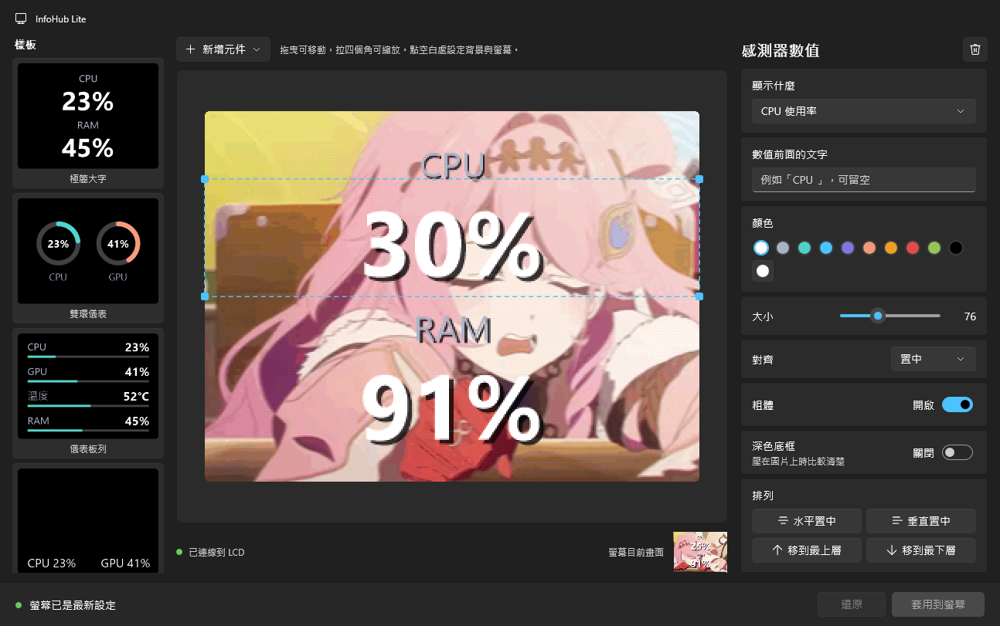
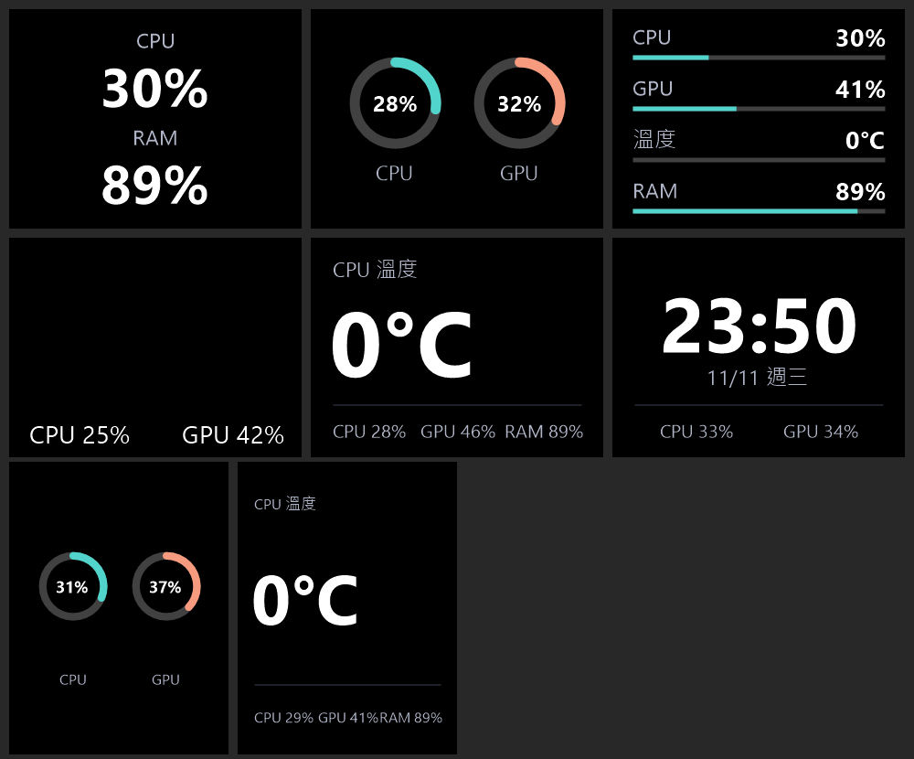

<p align="center"></p>

# InfoHubLite

輕量版的 InfoHub，用來驅動 **AYW Gaming LC 360 ARGB** 水冷頭上的 LCD 面板（USB `0B05:1C81`）。

官方程式要把每一張畫面逐像素轉成面板的格式，光這一步就吃掉約 1/5 個 CPU 核心。InfoHubLite 直接用 GDI+ 畫在面板原生的 RGB565 緩衝區上，沒有轉換這一步；常駐程式只有系統匣圖示，不載入任何 UI 框架，穩定運作時幾乎不配置記憶體。





## 功能

- **所見即所得編輯器**：編輯器和常駐程式用同一個繪圖器，畫布上看到的就是面板會顯示的；按「套用」之前不會影響面板
- **內建模板**：雙環儀表、儀表板列、角落資訊、主角數字、時鐘加資訊列、單環主角、三環；也可以存成自己的模板
- **感測器**：CPU／GPU 負載、溫度、RAM、風扇、電壓等（透過 [LibreHardwareMonitor](https://github.com/LibreHardwareMonitor/LibreHardwareMonitor)），只載入有用到的硬體
- **背景媒體**：PNG、JPG、BMP、GIF、MP4、AVI，匯入時一次轉成面板格式（`.ihl`），播放時只是讀檔加 USB 寫入
- **橫向／直向**畫面
- **系統匣**：開關螢幕、開啟設定、開機自動啟動、以系統管理員重新啟動

## 需求

- Windows 10 1809 以上，x64
- [.NET 10 Desktop Runtime](https://dotnet.microsoft.com/download/dotnet/10.0)
- 面板使用 Windows 內建的 WinUSB 驅動，不需要另外安裝驅動

## 使用

1. **先關掉官方 InfoHub**，否則裝置會被它佔用，InfoHubLite 開不了面板
2. 執行 `InfoHubLite.exe`，系統匣會出現圖示；從圖示選單開啟設定編輯版面
3. 溫度、風扇、電壓需要系統管理員權限才讀得到。從系統匣選「以系統管理員重新啟動（溫度／風扇／電壓）」即可

設定、媒體和自訂模板存在 `%AppData%\InfoHubLite`。

## 編譯

需要 .NET 10 SDK。

```powershell
dotnet build Engine -c Release
dotnet build Settings -c Release
```

輸出在 `dist/`：常駐程式是 `dist/InfoHubLite.exe`，設定編輯器在 `dist/Settings/`。

### 命令列（開發用）

`InfoHubLite.exe` 是視窗程式，要看輸出請接管線，例如 `.\InfoHubLite.exe selftest | Out-Host`。

| 指令 | 說明 |
|---|---|
| `selftest` | 檢查通訊格式、旋轉對應和媒體轉檔 |
| `sensors` | 列出這台電腦讀得到的感測器 |
| `render <out.png>` | 用目前的設定畫一張畫面存成 PNG，不碰裝置 |
| `template <名稱或編號> <out.png> [--portrait]` | 把內建模板畫成 PNG |
| `import <來源> <名稱> [--portrait] [--no-dither] [--crop x,y,w,h]` | 把圖片轉成 `.ihl` |
| `probe [次數]` | 送出目前畫面 N 次，量每次 USB 寫入的時間 |

## 免責聲明

本專案與 ASUS、AYW Gaming 沒有任何關係，也未經其授權或背書。面板的通訊協定是為了相容性而自行分析的，本專案不包含任何官方程式碼。使用風險自負。

## 授權

[MIT](LICENSE)

第三方元件：

- [LibreHardwareMonitor](https://github.com/LibreHardwareMonitor/LibreHardwareMonitor)：MPL-2.0
- [Windows App SDK](https://github.com/microsoft/WindowsAppSDK)：MIT
